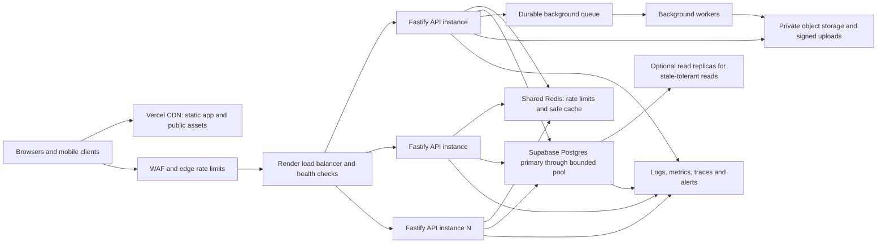

# OddJobs scalability and security plan

## Goal and capacity assumptions

“One million users” must be translated into an operating load before picking
instance sizes. One million registered accounts is not the same as one million
simultaneous users. Size from peak concurrent sessions, API requests per
second, read/write mix, largest request/response, file traffic, geography, and
burst duration.

Use this first-order estimate, then confirm it with workload tests:

```text
peak API RPS = peak concurrent users × average API requests per user per minute / 60
```

Add background work and a burst margin separately. Capacity is accepted only
when the measured system meets service-level objectives at the target peak and
continues to do so with one API instance unavailable.

Proposed initial objectives, to be confirmed against a production baseline:

- 99.9% monthly availability for the core API.
- API p95 latency under 500 ms for normal reads and writes, excluding user
  network latency and third-party authentication/storage calls.
- No loss of accepted job, bid, message, or payment-ledger writes after the
  API reports success.
- Documented database recovery targets and a verified restore procedure.

These are targets, not current guarantees. Availability also depends on the
chosen Render and Supabase plans, region, and operational configuration.

## Current application

- Frontend: React + Vite single-page app. Vite emits content-hashed assets.
- API: Fastify 5, TypeScript, and Prisma/Postgres adapter in `apps/api`.
- Identity: Supabase Auth tokens, verified by the API; database roles and
  resource ownership remain authoritative.
- Database: Supabase Postgres. The configured production endpoint observed
  during this work is in `eu-central-1`; measure the experience from Nairobi
  before choosing API placement or read replicas.
- Deployment described in `apps/api/README.md`: Vercel for the web app and
  Render for the API. Confirm that these are the intended production services
  before relying on their settings.

## Target request path



Keep the first production shape in one API/database region. Add edge distribution
for static content independently. Additional API or database regions should
follow measured latency and consistency needs, not precede them. A distant API
instance that still writes to the European primary may add a network hop
without reducing transaction latency.

## Scaling controls

### Frontend and CDN

Implemented in this repository:

- `vercel.json` applies immutable one-year caching to content-hashed `/assets/`
  bundles, one-day edge/browser caching to public brand images, and baseline
  security headers.
- The HTML shell is not assigned an immutable cache policy, allowing new
  deployments to expose the matching asset manifest.

Deployment gates:

- Confirm the actual Vercel project uses the repository root and `vercel.json`.
- Keep authenticated API traffic on the API origin; never apply a broad CDN
  cache rule to `/v1/*` or responses that vary by authorization.
- Measure browser performance from Nairobi on mobile connections. Split large
  route bundles, defer non-critical screens, resize/compress art and profile
  images, and avoid serial API request waterfalls where profiling shows them.
- Verify asset cache headers after deploy using response headers and a second
  request; confirm a new deploy serves its matching HTML and hashed bundles.

### API load balancing and autoscaling

The API is already stateless for ordinary HTTP requests: authentication is
token-based, and authoritative marketplace data is in Postgres. Render supports
multiple web-service instances behind its load balancer, health checks, and
autoscaling on eligible plans. The app already provides `/health/live`,
`/health/ready`, graceful `SIGTERM` shutdown, and an API request ID.

Configure in the Render service dashboard or infrastructure-as-code when the
service and plan are confirmed:

1. Run at least two API instances across separate availability zones where
   supported; set a nonzero minimum to avoid cold-scale delays.
2. Use `/health/ready` for traffic eligibility and `/health/live` for process
   liveness. Confirm startup completes before readiness and shutdown drains
   requests before the process exits.
3. Set minimum/maximum autoscaling bounds and CPU/memory targets from load-test
   data. Add request rate, latency, and queue depth as scaling signals if the
   hosting tier supports them.
4. Establish a manual rollback and staged rollout procedure. Keep schema
   changes backward-compatible with the prior API version during deployment.
5. Keep app instances in the same region as the primary database initially.

Autoscaling is not configured by source changes alone; it requires the hosting
account, service plan, budget, and deployment settings.

### Postgres capacity and connection pooling

Implemented in this repository:

- `DATABASE_POOL_MAX` configures the `pg`/Prisma adapter's maximum connection
  count per API process. It defaults to 5, and is validated from 1 to 50.
- Request JSON is capped at one MiB.
- API and health responses are assigned `Cache-Control: no-store` by a shared
  response hook so new routes do not accidentally become cacheable.

Required capacity calculation before horizontal scaling:

```text
maximum API instances × DATABASE_POOL_MAX
+ background worker connections
+ admin/migration/monitoring headroom
<= database pool's available backend connections
```

Keep the configured maximum comfortably below the provider's hard connection
limit, which is also shared with Supabase services. Monitor active connections,
pool wait time, transaction duration, CPU, memory, disk I/O, locks, and slow
queries. The production `DATABASE_URL` should use the Supabase connection mode
appropriate to a long-running API; migrations use the separate `DIRECT_URL`.
Validate Prisma's prepared-statement settings if using transaction pooling.

Before adding replicas, inspect slow query plans and fix missing indexes,
unbounded scans, N+1 reads, and large offsets. Marketplace feeds should use
bounded pagination and indexed filters. Keep write transactions short.

Supabase read replicas may serve suitable read-only browse or analytical
queries after the primary is measured as read-bound. They replicate
asynchronously: route read-after-write, payment, job-state, and authorization
checks to the primary unless the UI explicitly accepts staleness. Replicas do
not make writes scale horizontally.

### Cache strategy

Implemented now: Vercel static-asset cache rules and API `no-store` defaults.

Not implemented: Redis or application response caching. When introduced:

- Cache only public, non-personalized values such as categories or public
  browse results, with short TTLs and bounded payloads.
- Include normalized filters, area, sort order, and pagination in cache keys.
- Use TTL jitter and request coalescing to limit cache-stampede database load.
- Invalidate or version affected keys after job/profile changes.
- Never cache tokens, authorization decisions, private profiles, contact data,
  messages, bids visible only to a hirer, disputes, or wallet/payment records
  in shared caches.
- Use Redis for shared rate-limit counters if multiple API instances are
  active. The current Fastify limiter is process-local, so the effective limit
  increases with replica count and does not coordinate counters.

### Background work

The database has durable outbox records, but no worker/queue service is
deployed. Before notification fan-out or media-processing volume grows, connect
the outbox to a durable queue and background worker. Require idempotency,
bounded concurrency, retry with exponential backoff, dead-letter handling, and
queue-age alerts. Do not perform slow email, image, analytics, or export work
inside the user request.

## Security baseline

Implemented in the API: bearer-token verification, server-side role and
resource authorization, request schemas, Helmet, exact-origin CORS,
credential-redacted structured logs, request IDs, a per-process IP rate limit,
and reasoned/audited admin workflows.

Required before large-scale production:

- Put a managed WAF/bot and DDoS layer in front of public origins. Apply shared
  limits to login/OTP, password recovery, job creation, bidding, messaging,
  search, and payment actions. Use per-account and per-IP dimensions where
  appropriate; avoid locking out legitimate users behind shared mobile/NAT
  addresses.
- Do not trust arbitrary `X-Forwarded-For` headers. Configure proxy trust only
  for the actual trusted ingress and verify the origin cannot be bypassed.
- Keep service keys, database URLs, and signing secrets in a secret manager;
  rotate them and scope access by service/environment.
- Keep TLS enabled from browser to edge and edge to API; allow only required
  methods/origins; enforce body, upload, response, and execution limits.
- Review authorization for each resource ID (job, quote, message, payment,
  verification document) to prevent cross-user access. Test anonymous,
  hirer, worker, admin, wrong-owner, and suspended-account cases.
- Continue using private object storage and short-lived signed upload/download
  links for identity documents. Never cache private document responses.
- Keep financial events idempotent and auditable. No real-money collection or
  payout should be enabled until gateway callbacks, reconciliation, refunds,
  disputes, and operational ownership are implemented.

## Observability and recovery

Current code has JSON logs, request IDs, and health endpoints. It does not
include external continuous monitoring, distributed traces, managed dashboards,
or alert delivery. Configure these before a public traffic ramp:

- API: requests/sec, p50/p95/p99 latency, 4xx/5xx, rate-limits, event-loop and
  CPU/memory saturation, unhealthy instances, and dependency timeout rates.
- Database: CPU, connections, pool waits, slow queries, locks, disk/IOPS,
  replication lag, backup status, and storage growth.
- Cache/queue: hit ratio, memory/evictions, command latency, queue depth, oldest
  message age, retry counts, and dead-letter count.
- Synthetic probes from Nairobi and at least one other target market for login,
  job browse, and API health. Do not include real account credentials in probes.
- Alerts should page on sustained user-visible SLO failures, not isolated
  transient errors. Include request IDs and runbook links; redact secrets and
  personal data from logs.

Choose database backup/PITR retention from the agreed RPO/RTO. Run scheduled
restore drills into a separate project and verify both database records and
object-storage recovery. A backup that has never been restored is not a tested
recovery plan.

## Delivery phases and gates

| Phase | Work | Gate |
|---|---|---|
| 0. Baseline | Confirm hosting, regions, peak-load assumptions, SLOs, and cost ceiling; measure from Nairobi | Reproducible baseline dashboard and approved peak RPS target |
| 1. Safe foundation | Apply pool cap, body limit, API no-store defaults, static cache/security headers, health checks | Builds pass; deployment headers and health paths verified in staging |
| 2. Horizontal API | Configure multiple instances, health checks, autoscaling bounds, graceful deploy/rollback | Capacity target met with one instance unavailable |
| 3. Data-path tuning | Query plans, indexes, pagination, pool sizing, remove N+1 work | Database stays within connection and latency budgets at peak |
| 4. Shared controls | Managed WAF and shared Redis rate limiter/cache; move slow work to queue | Limits coordinate across replicas; retries are idempotent; queues alert |
| 5. Read/global scale | Add read replicas or regional read paths only for measured needs | Staleness behavior documented; primary writes remain correct |
| 6. Recovery | Restore drills, provider failure runbooks, external probes and alerts | Team demonstrates recovery within approved RPO/RTO |

## Load and failure exercises

Before each major traffic increase, run a non-production load profile based on
real anonymous/personalized traffic proportions: browse/search, profile reads,
post jobs, submit bids, messages, and payment-ledger reads/writes. Ramp, spike,
and soak workloads; monitor database pool wait and p95/p99 latency. Exercise one
API instance failure, slow database responses, cache outage, queue backlog, and
third-party auth/storage timeouts. Test only against isolated staging accounts
and databases, never production. Record the safe peak and repeat after major
schema or infrastructure changes.

## Provider references

- [Supabase connection pooling and limits](https://supabase.com/docs/guides/database/connecting-to-postgres/pooling-and-limits)
- [Supabase read replicas](https://supabase.com/docs/guides/platform/read-replicas)
- [Supabase database backups](https://supabase.com/docs/guides/platform/backups)
- [Render scaling](https://render.com/docs/scaling) and [health checks](https://render.com/docs/health-checks)
- [Vercel cache-control headers](https://vercel.com/docs/caching/cache-control-headers)
- [Cloudflare rate limiting](https://developers.cloudflare.com/waf/rate-limiting-rules/best-practices/)
- [OWASP API Security risks](https://devguide.owasp.org/en/07-training-education/07-api-top-ten/)
